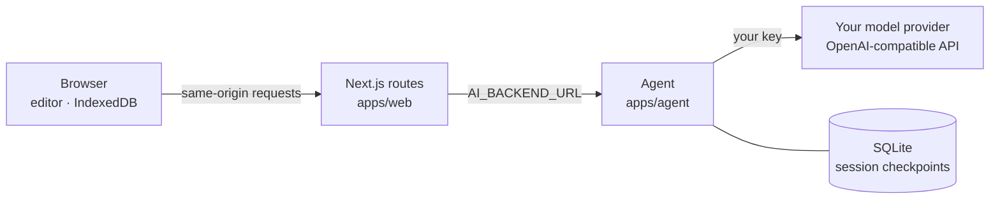

<div align="center">
  <a href="https://magic-resume.cn">
    
  </a>

  <h1>Magic Resume</h1>

  <p><strong>An open-source resume editor with a self-hosted AI agent.</strong><br/>Your resumes stay in your browser. The AI runs on your own model key.</p>

  <p>
    <a href="#quick-start"><strong>Quick start</strong></a>
    &nbsp;·&nbsp;
    <a href="./README.zh-CN.md">简体中文</a>
    &nbsp;·&nbsp;
    <a href="https://magic-resume.cn">magic-resume.cn</a>
    &nbsp;·&nbsp;
    <a href="https://github.com/Magic-Resume/Magic-Resume/issues">Report an issue</a>
  </p>

  [![][github-stars-shield]][github-stars-link]
  [![][github-forks-shield]][github-forks-link]
  [![][github-contributors-shield]][github-contributors-link]
  [![][github-issues-shield]][github-issues-link]
  [![][github-license-shield]][github-license-link]

</div>

<br/>


**Magic Resume is an open-source AI resume workbench: the AI proposes edits in place and you accept or skip each one.** MIT-licensed core, 20 templates, six modes (create, optimize, analyze, translate, interview, export), cloud sync.

> Magic Resume (magic-resume.cn) and the Magic Resume at magicv.art (魔方简历) are two independent open-source projects maintained by different teams.

This repository is the open-source edition. It contains the editor and **Polaris**, the AI resume assistant, together with the agent service that powers it. There is no account and no resume library on a server: resumes and one conversation per resume live in your browser's IndexedDB, and Polaris calls the model provider you configure with your own key. Interviews and multi-device cloud sync are part of the hosted product at [magic-resume.cn](https://magic-resume.cn).

<details>
<summary><strong>Table of contents</strong></summary>

- [Features](#features)
- [Quick start](#quick-start)
- [How Polaris works](#how-polaris-works)
- [Configuration](#configuration)
- [Open source and magic-resume.cn](#open-source-and-magic-resumecn)
- [Repository layout](#repository-layout)
- [Tech stack](#tech-stack)
- [MCP](#mcp)
- [Roadmap](#roadmap)
- [Contributing](#contributing)
- [License](#license)

</details>

## Features

### Editor


- **Live preview at print fidelity.** The page re-renders as you type; exports match what you see.
- **20 templates.** ATS-friendly, each with its own color, font, density, spacing and layout controls, on A4 or Letter.
- **Flexible sections.** Add, rename, reorder and hide sections; rich text with Tiptap; custom fields.
- **Import and export.** Open Magic Resume JSON offline. Export to PDF, PNG or JSON.
- **Local-first.** Everything is stored in IndexedDB. Nothing leaves the browser unless you use AI.
- **Light and dark themes, English and Chinese.**

### Polaris

- **Proposals, not overwrites.** Every change the AI makes appears as a diff on the canvas, with a reason for each edit. You accept or skip changes one by one; nothing is saved until you accept.
- **Skills.** Create a resume from scratch, optimize it for a job description, analyze it, score its fit against a role, or translate it. Each skill is a plain Markdown file you can read and change.
- **Three modes.** *Co-create* proposes edits, *Plan* reads the resume and proposes a plan without changing it, and *Ask* answers general questions without seeing your resume at all. The boundary is enforced by the backend, not only by the prompt.
- **Asks when it needs to.** When a fact is missing, such as the target role, the agent shows a structured form, pauses, and continues once you answer. The pause survives a page reload or a server restart.
- **Import any resume.** PDF, Word, images, Markdown or plain text. Scanned documents are read by a vision model.
- **Your own model.** Any OpenAI-compatible API, with presets for common providers. The key is encrypted in the browser and sent only with each request; the server never stores it.
- **No made-up experience.** The agent checks every proposed resume against your source material and flags employers, dates, credentials or numbers it cannot find there.

## Quick start

### Docker Compose (recommended)

Runs the editor and the agent together. Requires Docker with Compose v2.

```bash
git clone https://github.com/Magic-Resume/Magic-Resume.git
cd Magic-Resume
docker compose up --build
```

Open [http://localhost:3000](http://localhost:3000), go to **Settings → Model**, choose a provider, enter your API key and model, test the connection and save. Polaris is then ready.

The editor listens on `127.0.0.1:3000`. The agent has no published port and is reachable only from the editor container; its sessions are kept in the `agent-data` volume.

### Local development

Requires Node.js 22.13 or later and pnpm 10.28.

```bash
git clone https://github.com/Magic-Resume/Magic-Resume.git
cd Magic-Resume
pnpm install
cp apps/web/.env.example apps/web/.env.local   # then uncomment AI_BACKEND_URL=http://localhost:4000
pnpm dev
```

`pnpm dev` starts the editor on [http://localhost:3000](http://localhost:3000) and the agent on `http://127.0.0.1:4000`. Editing works without the agent; only Polaris needs it.

To point the agent at a model server on your own machine or network (for example a local OpenAI-compatible proxy), start it with `AGENT_ALLOW_PRIVATE_MODEL_HOSTS=true`. This switch is ignored when `NODE_ENV=production`.

### Editor only

The editor is a standard Next.js app and runs without the agent:

```bash
docker build -f apps/web/Dockerfile -t magic-resume-web .
docker run -p 3000:3000 magic-resume-web
```

[](https://vercel.com/new/clone?repository-url=https%3A%2F%2Fgithub.com%2FMagic-Resume%2FMagic-Resume)

To enable Polaris later, run the agent somewhere the editor can reach and set `AI_BACKEND_URL` on the editor.

## How Polaris works



- **The browser owns the resume.** Each request carries a snapshot of the current resume (except in Ask mode). The agent works on a draft and returns proposals; the browser saves what you accept. The draft lives only in the session's checkpoint and is deleted with it.
- **The agent** (`apps/agent`) is a [DeepAgents](https://github.com/langchain-ai/deepagentsjs) harness on LangGraph with a Fastify HTTP layer. It mounts the skills directory read-only, gives the model a scratch workspace holding the resume draft, and runs a middleware chain that enforces the run budget, mode boundaries, each skill's tool allowlist, resume schema validation and the fabrication check.
- **Sessions** are LangGraph checkpoints in SQLite, so a paused form, a page reload or a restart resumes where it left off. Idle sessions expire after seven days.
- **Your key** stays in the request: it is never logged, written to a checkpoint or stored on disk. The agent resolves the provider's address once per request, pins the connection to it, refuses private network addresses and does not follow redirects.
- **The protocol** between the editor and the agent is documented in [docs/reference/ai-backend.md](./docs/reference/ai-backend.md), and the agent's design in [docs/specs/agent-backend/design.md](./docs/specs/agent-backend/design.md). You can replace the agent with your own implementation of the same contract.

> [!IMPORTANT]
> The agent has no user accounts. Keep it on a private network, as Docker Compose does, or put authentication in front of it before exposing it to other people.

## Configuration

Model settings (provider, key, base URL, model, output limit, reasoning strength) are configured per browser in **Settings → Model**. Server settings are environment variables; all are optional.

<details>
<summary><strong>Editor (<code>apps/web</code>)</strong></summary>

<br/>

| Variable | Default | Purpose |
|---|---|---|
| `AI_BACKEND_URL` | — | Server-only origin of the agent, without `/api`. AI requests return 503 when it is unset. |
| `NEXT_PUBLIC_APP_URL` | `http://localhost:3000` | Public origin, used for `robots.txt` and page metadata. |
| `APP_PUBLIC_URL` | — | Same as above, read at request time so one image can serve several domains. |
| `NEXT_PUBLIC_DOCS_URL` | — | Target of the "Help center" menu item; hidden when unset. |

</details>

<details>
<summary><strong>Agent (<code>apps/agent</code>)</strong></summary>

<br/>

| Variable | Default | Purpose |
|---|---|---|
| `HOST` / `PORT` | `127.0.0.1` / `4000` | Listen address. |
| `AGENT_DATA_DIR` | `./data` | SQLite checkpoints and other runtime state. |
| `AGENT_SKILLS_DIR` | bundled `skills/` | Directory of skills to mount. |
| `AGENT_MAX_MODEL_CALLS` / `AGENT_MAX_TOOL_CALLS` | `40` / `60` | Budget per turn, shared with sub-agents. |
| `AGENT_IDLE_TIMEOUT_MS` | `120000` | Longest silence from the model before a turn fails. |
| `AGENT_RUN_TIMEOUT_MS` | `900000` | Upper bound for one turn. |
| `AGENT_SESSION_TTL_HOURS` | `168` | Idle sessions are deleted after this. |
| `AGENT_BODY_LIMIT_BYTES` | `2097152` | Largest accepted JSON request. |
| `AGENT_ALLOW_PRIVATE_MODEL_HOSTS` | `false` | Allow model servers on private networks. Ignored in production. |

See [`apps/agent/README.md`](./apps/agent/README.md) for the full list, how to write a skill, and a smoke test against a real model.

</details>

## Open source and magic-resume.cn

The editor and templates are the same; the hosted product runs the AI for you and adds accounts, sync and interviews.

| | Open source (this repository) | magic-resume.cn |
|---|---|---|
| License | MIT | Free tier and paid plans |
| Account | Not required | Required |
| Resume storage | Your browser (IndexedDB) | Encrypted cloud storage, exportable at any time |
| Multi-device sync | — | Yes |
| AI | Polaris with your own model key, on the bundled agent | Managed models, mock interviews and memory |
| Templates | 20 | 20 |

## Repository layout

A pnpm and Turborepo monorepo. The shared schema, templates, design system, icons, utilities and the MCP server are published from [magic-resume-kit](https://github.com/Magic-Resume/magic-resume-kit) as `@magic-resume-kit/*` and pinned here by exact version.

| Path | Description |
|---|---|
| `apps/web` | The editor and Polaris (Next.js) |
| `apps/agent` | The agent behind Polaris (Fastify, DeepAgents, SQLite) |
| `apps/agent/skills` | Skills and the agent's standing instructions, as Markdown |
| `apps/landing` | Marketing site for magic-resume.cn (Astro) |
| `apps/docs` | Documentation site (Mintlify) |
| `packages/genui` | Polaris cards and widgets |
| `packages/tsconfig` | Shared TypeScript configuration |

```bash
pnpm dev                                    # editor and agent
pnpm build                                  # build every workspace
pnpm lint                                   # lint and architecture checks
pnpm test                                   # tests
pnpm --filter @magic-resume/agent test      # one workspace
```

## Tech stack

| Area | Technology |
|---|---|
| Editor | [Next.js 16](https://nextjs.org/), [React 19](https://react.dev/), [TypeScript](https://www.typescriptlang.org/), [Tailwind CSS 4](https://tailwindcss.com/), [Radix UI](https://www.radix-ui.com/), [Tiptap](https://tiptap.dev/), [Zustand](https://zustand-demo.pmnd.rs/), [i18next](https://www.i18next.com/) |
| Documents | [React-PDF](https://react-pdf.org/), [PDF.js](https://mozilla.github.io/pdf.js/), [Zod](https://zod.dev/) schemas |
| Agent | [DeepAgents](https://github.com/langchain-ai/deepagentsjs), [LangGraph](https://langchain-ai.github.io/langgraphjs/), [LangChain](https://js.langchain.com/), [Fastify](https://fastify.dev/), SQLite |
| Tooling | [pnpm](https://pnpm.io/), [Turborepo](https://turbo.build/), ESLint, Docker |

## MCP

[`@magic-resume-kit/mcp`](./docs/reference/mcp.md) is a Model Context Protocol server that lets AI coding tools such as Claude Code, Codex and Cursor read and edit resumes through schema-aware JSON Patch. It connects to a magic-resume.cn account; the local editor in this repository has no account API for it to reach.

```bash
npx -y @magic-resume-kit/mcp@1.0.1 --help
```

## Roadmap

- [x] Local-first editor with 20 templates
- [x] Polaris on your own model key, with a self-hosted agent
- [x] Resumable sessions, structured forms and approvals
- [x] Import from PDF, Word, images and Markdown
- [ ] Attachments in conversations
- [ ] Optional web search with your own search API key, for company and role research

Ideas and requests are welcome in [issues](https://github.com/Magic-Resume/Magic-Resume/issues).

## Contributing

Contributions of every size are welcome: bug fixes, templates, skills, translations, docs and features. Read the [contributing guide](./CONTRIBUTING.md) for local setup, the branch workflow and the commit convention (gitmoji with Conventional Commits). For anything non-trivial, open an issue first to agree on the approach.

<a href="https://github.com/Magic-Resume/Magic-Resume/graphs/contributors">
  
</a>

## Star history

<a href="https://star-history.com/#Magic-Resume/Magic-Resume&Date">
  
</a>

## License

[MIT](./LICENSE) © 2026 [Magic Resume Team](https://github.com/Magic-Resume)

<!-- LINK GROUP -->

[github-contributors-shield]: https://img.shields.io/github/contributors/Magic-Resume/Magic-Resume?color=c4f042&labelColor=black&style=flat-square
[github-contributors-link]: https://github.com/Magic-Resume/Magic-Resume/graphs/contributors
[github-forks-shield]: https://img.shields.io/github/forks/Magic-Resume/Magic-Resume?color=8ae8ff&labelColor=black&style=flat-square
[github-forks-link]: https://github.com/Magic-Resume/Magic-Resume/network/members
[github-stars-shield]: https://img.shields.io/github/stars/Magic-Resume/Magic-Resume?color=ffcb47&labelColor=black&style=flat-square
[github-stars-link]: https://github.com/Magic-Resume/Magic-Resume/stargazers
[github-issues-shield]: https://img.shields.io/github/issues/Magic-Resume/Magic-Resume?color=ff80eb&labelColor=black&style=flat-square
[github-issues-link]: https://github.com/Magic-Resume/Magic-Resume/issues
[github-license-shield]: https://img.shields.io/badge/license-MIT-white?labelColor=black&style=flat-square
[github-license-link]: https://github.com/Magic-Resume/Magic-Resume/blob/master/LICENSE
