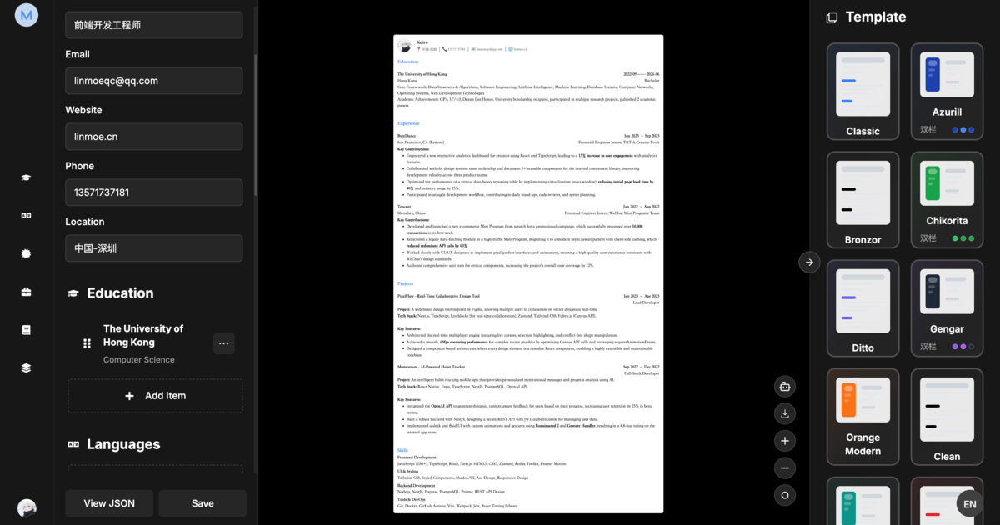

<div align="center">
  <a href="https://magic-resume.cn">
    
  </a>

  <h1>Magic Resume</h1>

  <p><strong>The open-source resume editor.</strong><br/>Local resume storage, with an optional AI Lab using your own model key and backend.</p>

  <p>
    <a href="https://magic-resume.cn"><strong>Get Started »</strong></a>
    &nbsp;·&nbsp;
    <a href="./README.zh-CN.md">简体中文</a>
    &nbsp;·&nbsp;
    <a href="https://magic-resume.cn">Official Site</a>
    &nbsp;·&nbsp;
    <a href="https://github.com/Magic-Resume/Magic-Resume/issues">Feedback</a>
  </p>

  <!-- SHIELD GROUP -->

  [![][vercel-shield]][vercel-link]
  [![][github-stars-shield]][github-stars-link]
  [![][github-forks-shield]][github-forks-link]
  [![][github-contributors-shield]][github-contributors-link]
  [![][github-issues-shield]][github-issues-link]
  [![][github-license-shield]][github-license-link]

</div>

<br/>



<br/>

**Magic Resume is an open-source AI resume workbench: the AI proposes edits in place and you accept or skip each one.** MIT-licensed core, 20 templates, six modes (create, optimize, analyze, translate, interview, export), cloud sync.

> Magic Resume (magic-resume.cn) and the Magic Resume at magicv.art (魔方简历) are two independent open-source projects maintained by different teams.

This repository is the MIT-licensed local editor with an optional BYOK AI Lab. Editing and export need no account or backend. Resumes and one conversation per resume stay in IndexedDB. When you use AI, your messages, relevant resume content, attachments and model key are sent through the app to your own AI backend. Cloud sync and managed AI are part of [magic-resume.cn](https://magic-resume.cn).

## Open source vs magic-resume.cn

Same editor and templates; the hosted product manages the AI backend and adds accounts and sync.

| | Open source (this repo) | magic-resume.cn |
|---|---|---|
| License | MIT, free forever | Free tier + paid plans |
| Account | Not required | Required |
| Data storage | Your browser's IndexedDB only | Encrypted cloud storage, exportable anytime |
| Multi-device sync | No | Yes |
| AI Lab | BYOK + your own compatible backend; no interviews or memory | Managed AI, interviews and memory |
| Backend | Optional for AI; deploy separately | Hosted for you |
| Templates | 20, identical | 20, identical |

> [!NOTE]
> Version 3 removes accounts, cloud sync and billing. AI Lab uses BYOK through a configurable backend; this repository provides the UI and proxy, not the backend implementation. See the [CHANGELOG](./CHANGELOG.md) for what changed.

---

## Features

- **Real-time preview**: the page re-renders as you type, at print fidelity.
- **20 templates**: ATS-friendly, each with color, font, spacing and layout controls.
- **Custom sections**: add, rename, reorder and hide sections; edit rich text with Tiptap.
- **JSON view**: inspect the resume's raw data and download it.
- **Import and export**: import Magic Resume JSON locally; parse PDF, Word, images and Markdown with AI. Export to PDF, PNG or JSON.
- **Local-first**: resumes and chat history persist in IndexedDB. Only explicit AI operations send content to your configured backend. No analytics are sent.
- **Light and dark themes, English and Chinese UI.**

---

## Templates

Twenty hand-crafted, ATS-friendly templates, each fully customizable (color, font, spacing, layout):

`classic` · `azurill` · `bronzor` · `chikorita` · `ditto` · `gengar` · `orange-modern` · `clean-minimal` · `teal-professional` · `red-accent` · `golden-elegant` · `product-ops-focus` · `compact-cn-photo` · `executive-band` · `timeline-pro` · `skills-first` · `serif-minimal` · `slate-sidebar` · `cn-formal-photo` · `blue-line`

---

## Quick Start

```bash
git clone https://github.com/Magic-Resume/Magic-Resume.git
cd Magic-Resume
pnpm install
pnpm run dev
```

Open [http://localhost:3000](http://localhost:3000). No `.env` file is needed; `apps/web/.env.example` lists the few optional settings.

---

## Self-Hosting

Editing needs only a Next.js server. To enable AI, set `AI_BACKEND_URL` to your compatible backend and add a key in Settings → Model. See the [backend contract](./docs/reference/ai-backend.md). Pick one:

**Docker**

```bash
docker build -f apps/web/Dockerfile -t magic-resume .
docker run -p 3000:3000 magic-resume
```

**Vercel**

[](https://vercel.com/new/clone?repository-url=https%3A%2F%2Fgithub.com%2FMagic-Resume%2FMagic-Resume)

<details>
<summary><strong>Environment variables (all optional)</strong></summary>

<br/>

| Variable | Default | Purpose |
|---|---|---|
| `NEXT_PUBLIC_APP_URL` | `http://localhost:3000` | Public origin, used for `robots.txt` and page metadata. |
| `APP_PUBLIC_URL` | — | Same as above, read at request time, so one image can serve several domains. |
| `AI_BACKEND_URL` | — | Server-only origin of your own AI backend; missing configuration returns 503 for AI requests. |
| `NEXT_PUBLIC_DOCS_URL` | — | Target of the "Help center" menu item; the item is hidden when unset. |

</details>

---

## MCP

`packages/mcp` (`@magic-resume/mcp`) is a Model Context Protocol server that lets AI tools (Claude Code, Cursor, Windsurf) read and patch resumes through schema-aware JSON Patch. It talks to a Magic Resume account over its API, so it works with magic-resume.cn; the local editor in this repository has no server for it to reach. See [docs/reference/mcp.md](./docs/reference/mcp.md).

---

## Roadmap

A small open-source backend implementation is planned separately. The BYOK UI and [HTTP/SSE contract](./docs/reference/ai-backend.md) are available now; pointing at an ordinary model API alone is insufficient because the backend must implement the agent protocol.

---

## Tech Stack

| Layer | Technology |
|---|---|
| Monorepo | [Turborepo](https://turbo.build/), [pnpm](https://pnpm.io/) |
| Framework | [Next.js 16](https://nextjs.org/) (App Router, Turbopack) |
| Language | [TypeScript](https://www.typescriptlang.org/) |
| Styling | [Tailwind CSS 4](https://tailwindcss.com/) |
| UI | [Radix UI](https://www.radix-ui.com/), [React Aria](https://react-spectrum.adobe.com/react-aria/) |
| Animation | [Framer Motion](https://www.framer.com/motion/) |
| State | [Zustand](https://zustand-demo.pmnd.rs/) |
| Storage | [IndexedDB](https://developer.mozilla.org/en-US/docs/Web/API/IndexedDB_API) |
| Editor | [Tiptap](https://tiptap.dev/) |
| PDF | [React-PDF](https://react-pdf.org/), [PDF.js](https://mozilla.github.io/pdf.js/) |
| Schema | [Zod](https://zod.dev/) |
| i18n | [i18next](https://www.i18next.com/) |

---

## Monorepo

| Workspace | Description |
|---|---|
| `apps/web` | The editor (Next.js) |
| `apps/landing` | Marketing site for magic-resume.cn (Astro) |
| `apps/docs` | Documentation site (Mintlify) |
| `packages/resume-schema` | Shared Zod schemas, types and sample data |
| `packages/resume-templates` | Template DSL, renderer and registry |
| `packages/genui` | AI Lab components and widgets |
| `packages/design-system` | Design tokens and shared styles |
| `packages/icons` | Icon set |
| `packages/utils` | Small helpers (`cn`, time, color) |
| `packages/mcp` | `@magic-resume/mcp`, stdio MCP server and CLI |
| `packages/tsconfig` | Shared TypeScript configs |

```bash
pnpm install            # install everything
pnpm run dev            # start all workspaces
pnpm run lint           # lint and architecture checks
pnpm run test           # test

# target a single workspace
pnpm --filter @magic-resume/web dev
pnpm --filter @magic-resume/mcp build
```

---

## Contributing

Contributions of every size are welcome — bug fixes, new templates, docs, translations, or features.

Please read the **[Contributing Guide](./CONTRIBUTING.md)** for local setup, the branch workflow, and the enforced **gitmoji + Conventional Commits** convention. For bugs or ideas, feel free to file an [issue](https://github.com/Magic-Resume/Magic-Resume/issues) first.

<a href="https://github.com/Magic-Resume/Magic-Resume/graphs/contributors">
  
</a>

---

## Star History

<a href="https://star-history.com/#Magic-Resume/Magic-Resume&Date">
  
</a>

---

<div align="center">

Copyright © 2026 [Magic Resume Team](https://github.com/Magic-Resume) · [MIT](./LICENSE) licensed.

</div>

<!-- LINK GROUP -->

[official-site]: https://magic-resume.cn
[vercel-shield]: https://img.shields.io/badge/vercel-online-55b467?labelColor=black&logo=vercel&style=flat-square
[vercel-link]: https://magic-resume.cn
[github-contributors-shield]: https://img.shields.io/github/contributors/Magic-Resume/Magic-Resume?color=c4f042&labelColor=black&style=flat-square
[github-contributors-link]: https://github.com/Magic-Resume/Magic-Resume/graphs/contributors
[github-forks-shield]: https://img.shields.io/github/forks/Magic-Resume/Magic-Resume?color=8ae8ff&labelColor=black&style=flat-square
[github-forks-link]: https://github.com/Magic-Resume/Magic-Resume/network/members
[github-stars-shield]: https://img.shields.io/github/stars/Magic-Resume/Magic-Resume?color=ffcb47&labelColor=black&style=flat-square
[github-stars-link]: https://github.com/Magic-Resume/Magic-Resume/stargazers
[github-issues-shield]: https://img.shields.io/github/issues/Magic-Resume/Magic-Resume?color=ff80eb&labelColor=black&style=flat-square
[github-issues-link]: https://github.com/Magic-Resume/Magic-Resume/issues
[github-license-shield]: https://img.shields.io/badge/license-MIT-white?labelColor=black&style=flat-square
[github-license-link]: https://github.com/Magic-Resume/Magic-Resume/blob/master/LICENSE
