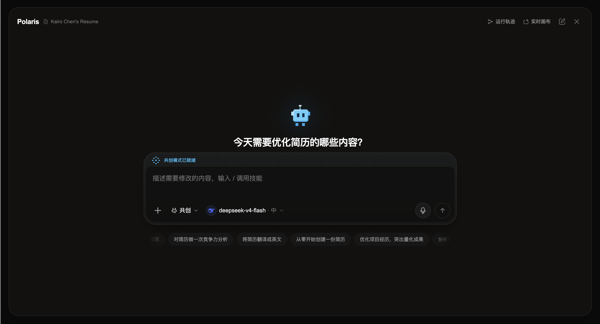
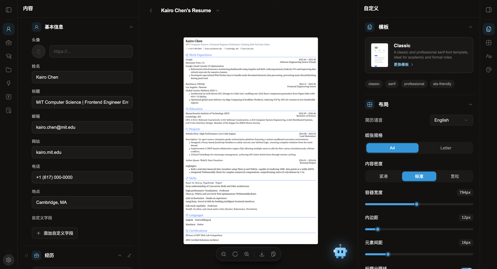
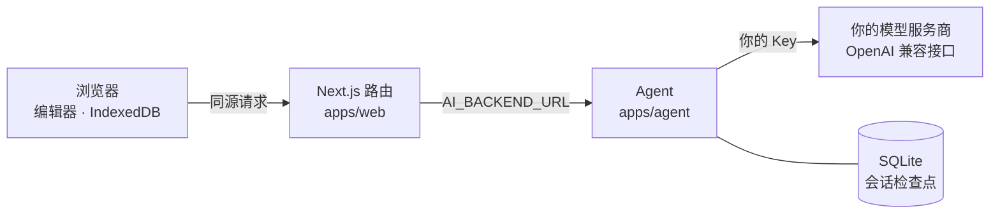

<div align="center">
  <a href="https://magic-resume.cn">
    
  </a>

  <h1>Magic Resume</h1>

  <p><strong>开源的简历编辑器，自带可自部署的 AI agent。</strong><br/>简历只保存在你的浏览器里，AI 用你自己的模型 Key。</p>

  <p>
    <a href="#快速开始"><strong>快速开始</strong></a>
    &nbsp;·&nbsp;
    <a href="./README.md">English</a>
    &nbsp;·&nbsp;
    <a href="https://magic-resume.cn">magic-resume.cn</a>
    &nbsp;·&nbsp;
    <a href="https://github.com/Magic-Resume/Magic-Resume/issues">反馈问题</a>
  </p>

  [![][github-stars-shield]][github-stars-link]
  [![][github-forks-shield]][github-forks-link]
  [![][github-contributors-shield]][github-contributors-link]
  [![][github-issues-shield]][github-issues-link]
  [![][github-license-shield]][github-license-link]

</div>

<br/>



**Magic Resume 是开源的 AI 简历工作台：AI 就地提出修改建议，你逐条决定采纳或跳过。** MIT 协议内核，20 套模板，六种工作模式（创建、优化、分析、翻译、面试、导出），多设备云同步。

> Magic Resume（magic-resume.cn）与 magicv.art 的 Magic Resume（魔方简历）是两个由不同团队维护的独立开源项目。

本仓库是开源版，包含编辑器、AI 简历助手 **Polaris**，以及驱动 Polaris 的 agent 服务。不需要账号，服务器上也没有简历库：简历和每份简历唯一的对话都保存在浏览器的 IndexedDB 里，Polaris 用你自己的 Key 调用你配置的模型服务商。模拟面试和多设备云同步由托管版 [magic-resume.cn](https://magic-resume.cn) 提供。

<details>
<summary><strong>目录</strong></summary>

- [功能](#功能)
- [快速开始](#快速开始)
- [Polaris 如何工作](#polaris-如何工作)
- [配置](#配置)
- [开源版与 magic-resume.cn](#开源版与-magic-resumecn)
- [仓库结构](#仓库结构)
- [技术栈](#技术栈)
- [MCP](#mcp)
- [路线图](#路线图)
- [参与贡献](#参与贡献)
- [许可证](#许可证)

</details>

## 功能

### 编辑器



- **实时预览，所见即打印。** 边输入边重新排版，导出结果与预览一致。
- **20 套模板。** 对 ATS 友好，每套都可以单独调整颜色、字体、内容密度、间距和版式，支持 A4 与 Letter。
- **灵活的模块。** 增删、重命名、排序、隐藏模块；Tiptap 富文本；自定义字段。
- **导入与导出。** 离线打开 Magic Resume JSON；导出 PDF、PNG 或 JSON。
- **本地优先。** 所有数据存在 IndexedDB，除非你使用 AI，任何内容都不会离开浏览器。
- **深色与浅色主题，中文与英文界面。**

### Polaris

- **提议，而不是覆盖。** AI 的每一处修改都以差异的形式出现在画布上，并附带修改理由。你逐条采纳或跳过；采纳之前什么都不会保存。
- **技能。** 从零创建简历、针对岗位描述优化、诊断分析、评估与岗位的匹配度、翻译。每个技能都是一份 Markdown 文件，可以直接阅读和修改。
- **三种模式。** *共创* 会提出修改；*计划* 读取简历、给出方案，但不改动；*问答* 回答一般问题，完全看不到你的简历。这条边界由后端强制执行，不只靠提示词。
- **需要时会问你。** 缺少关键信息（比如目标岗位）时，agent 会弹出结构化表单并暂停，你填完后接着执行。暂停状态在刷新页面、甚至重启服务后依然保留。
- **导入任意格式的简历。** PDF、Word、图片、Markdown 或纯文本；扫描件交给视觉模型识别。
- **用你自己的模型。** 支持任何 OpenAI 兼容接口，内置常见服务商预设。Key 在浏览器中加密保存，只随每次请求发送，服务器不会存储。
- **不编造经历。** agent 会把每份修改提案与你的原始材料比对，标出原文里找不到的雇主、日期、证书或数字。

## 快速开始

### Docker Compose（推荐）

同时启动编辑器和 agent。需要 Docker 和 Compose v2。

```bash
git clone https://github.com/Magic-Resume/Magic-Resume.git
cd Magic-Resume
docker compose up --build
```

打开 [http://localhost:3000](http://localhost:3000)，进入 **设置 → 模型**，选择服务商，填写 API Key 和模型，测试连接后保存，就可以使用 Polaris 了。

编辑器监听 `127.0.0.1:3000`。agent 不对外暴露端口，只有编辑器容器能访问它；会话数据保存在 `agent-data` 卷中。

### 本地开发

需要 Node.js 22.13 及以上版本和 pnpm 10.28。

```bash
git clone https://github.com/Magic-Resume/Magic-Resume.git
cd Magic-Resume
pnpm install
cp apps/web/.env.example apps/web/.env.local   # 然后取消 AI_BACKEND_URL=http://localhost:4000 的注释
pnpm dev
```

`pnpm dev` 会在 [http://localhost:3000](http://localhost:3000) 启动编辑器，在 `http://127.0.0.1:4000` 启动 agent。编辑不依赖 agent，只有 Polaris 需要它。

如果模型服务在你自己的电脑或内网里（例如本地的 OpenAI 兼容代理），启动 agent 时加上 `AGENT_ALLOW_PRIVATE_MODEL_HOSTS=true`。`NODE_ENV=production` 时这个开关不生效。

### 只部署编辑器

编辑器是标准的 Next.js 应用，没有 agent 也能运行：

```bash
docker build -f apps/web/Dockerfile -t magic-resume-web .
docker run -p 3000:3000 magic-resume-web
```

[](https://vercel.com/new/clone?repository-url=https%3A%2F%2Fgithub.com%2FMagic-Resume%2FMagic-Resume)

之后想启用 Polaris，把 agent 部署在编辑器能访问到的地方，再给编辑器设置 `AI_BACKEND_URL` 即可。

## Polaris 如何工作



- **简历归浏览器所有。** 每次请求携带当前简历的快照（问答模式除外）。agent 在草稿上工作并返回修改提案，浏览器保存你采纳的部分。草稿只存在于会话检查点中，随会话一起删除。
- **agent**（`apps/agent`）基于 LangGraph 上的 [DeepAgents](https://github.com/langchain-ai/deepagentsjs) harness，HTTP 层用 Fastify。它以只读方式挂载技能目录，给模型一个存放简历草稿的临时工作区，并用一串中间件强制执行运行预算、模式边界、每个技能的工具白名单、简历 schema 校验和防编造检查。
- **会话** 是存在 SQLite 中的 LangGraph 检查点，所以表单暂停、刷新页面或重启服务之后都能从原处继续。闲置会话七天后自动删除。
- **你的 Key** 只存在于请求中：不写日志、不进检查点、不落盘。agent 每次请求只解析一次服务商地址并固定连接，拒绝私网地址，也不跟随重定向。
- **编辑器与 agent 之间的协议** 见 [docs/reference/ai-backend.md](./docs/reference/ai-backend.md)，agent 的设计见 [docs/specs/agent-backend/design.md](./docs/specs/agent-backend/design.md)。你也可以按同一份协议自行实现后端，替换掉它。

> [!IMPORTANT]
> agent 没有用户账号体系。请把它放在内网中（Docker Compose 默认如此），或在开放给他人使用前，在前面加一层鉴权。

## 配置

模型设置（服务商、Key、Base URL、模型、输出上限、推理强度）在 **设置 → 模型** 中按浏览器分别配置。服务端设置都是环境变量，全部可选。

<details>
<summary><strong>编辑器（<code>apps/web</code>）</strong></summary>

<br/>

| 变量 | 默认值 | 作用 |
|---|---|---|
| `AI_BACKEND_URL` | — | agent 的服务端地址，不带 `/api`。未设置时 AI 请求返回 503。 |
| `NEXT_PUBLIC_APP_URL` | `http://localhost:3000` | 公开访问地址，用于 `robots.txt` 和页面元数据。 |
| `APP_PUBLIC_URL` | — | 同上，但在请求时读取，同一个镜像可以服务多个域名。 |
| `NEXT_PUBLIC_DOCS_URL` | — | 「帮助中心」菜单的链接，未设置时隐藏。 |

</details>

<details>
<summary><strong>Agent（<code>apps/agent</code>）</strong></summary>

<br/>

| 变量 | 默认值 | 作用 |
|---|---|---|
| `HOST` / `PORT` | `127.0.0.1` / `4000` | 监听地址。 |
| `AGENT_DATA_DIR` | `./data` | SQLite 检查点等运行时数据。 |
| `AGENT_SKILLS_DIR` | 自带的 `skills/` | 要挂载的技能目录。 |
| `AGENT_MAX_MODEL_CALLS` / `AGENT_MAX_TOOL_CALLS` | `40` / `60` | 每轮预算，与子代理共享。 |
| `AGENT_IDLE_TIMEOUT_MS` | `120000` | 模型最长无输出时间，超过即判定本轮失败。 |
| `AGENT_RUN_TIMEOUT_MS` | `900000` | 单轮时长上限。 |
| `AGENT_SESSION_TTL_HOURS` | `168` | 闲置会话超过这个时间后删除。 |
| `AGENT_ATTACHMENT_TTL_HOURS` | `24` | 对话附件的有效小时数，过期后删除。 |
| `AGENT_ATTACHMENT_SECRET` | 启动时随机生成 | 可选的固定 HMAC 密钥，至少 32 字符；读取地址最长有效 15 分钟。 |
| `AGENT_MAX_SEARCHES` | `5` | 每轮搜索次数上限，同时计入共享工具预算。 |
| `SEARCH_PROVIDER` | — | 可选 `tavily`、`brave` 或 `searxng`；配置不完整时不提供搜索及研究技能。 |
| `SEARCH_API_KEY` | — | Tavily 和 Brave 必填。 |
| `SEARCH_BASE_URL` | 服务商默认地址 | 可覆盖 API 基址；SearXNG 必填，不默认使用公开实例。私网地址沿用模型的非生产显式放行规则。 |
| `AGENT_BODY_LIMIT_BYTES` | `2097152` | 可接受的最大 JSON 请求体。 |
| `AGENT_ALLOW_PRIVATE_MODEL_HOSTS` | `false` | 允许连接内网的模型服务；生产环境下不生效。 |

完整列表、如何编写技能，以及用真实模型做冒烟测试的步骤，见 [`apps/agent/README.md`](./apps/agent/README.md)。

</details>

## 开源版与 magic-resume.cn

编辑器和模板相同；托管版替你运行 AI，并提供账号、同步和模拟面试。

| | 开源版（本仓库） | magic-resume.cn |
|---|---|---|
| 授权 | MIT | 免费额度与付费计划 |
| 账号 | 不需要 | 需要 |
| 简历存储 | 你的浏览器（IndexedDB） | 加密云端存储，随时可完整导出 |
| 多设备同步 | — | 支持 |
| AI | Polaris，使用自带的 agent 和你自己的模型 Key | 托管模型、模拟面试与记忆 |
| 模板 | 20 套 | 20 套 |

## 仓库结构

pnpm + Turborepo 单仓。共享的 schema、模板、设计系统、图标、工具函数和 MCP 服务从 [magic-resume-kit](https://github.com/Magic-Resume/magic-resume-kit) 发布为 `@magic-resume-kit/*`，本仓库按精确版本引用。

| 路径 | 说明 |
|---|---|
| `apps/web` | 编辑器与 Polaris（Next.js） |
| `apps/agent` | Polaris 背后的 agent（Fastify、DeepAgents、SQLite） |
| `apps/agent/skills` | 技能和 agent 的常驻规则，均为 Markdown |
| `apps/landing` | magic-resume.cn 官网（Astro） |
| `apps/docs` | 文档站（Mintlify） |
| `packages/genui` | Polaris 的卡片与组件 |
| `packages/tsconfig` | 共享的 TypeScript 配置 |

```bash
pnpm dev                                    # 编辑器和 agent
pnpm build                                  # 构建所有工作区
pnpm lint                                   # lint 与架构检查
pnpm test                                   # 测试
pnpm --filter @magic-resume/agent test      # 单个工作区
```

## 技术栈

| 领域 | 技术 |
|---|---|
| 编辑器 | [Next.js 16](https://nextjs.org/)、[React 19](https://react.dev/)、[TypeScript](https://www.typescriptlang.org/)、[Tailwind CSS 4](https://tailwindcss.com/)、[Radix UI](https://www.radix-ui.com/)、[Tiptap](https://tiptap.dev/)、[Zustand](https://zustand-demo.pmnd.rs/)、[i18next](https://www.i18next.com/) |
| 文档 | [React-PDF](https://react-pdf.org/)、[PDF.js](https://mozilla.github.io/pdf.js/)、[Zod](https://zod.dev/) schema |
| Agent | [DeepAgents](https://github.com/langchain-ai/deepagentsjs)、[LangGraph](https://langchain-ai.github.io/langgraphjs/)、[LangChain](https://js.langchain.com/)、[Fastify](https://fastify.dev/)、SQLite |
| 工具链 | [pnpm](https://pnpm.io/)、[Turborepo](https://turbo.build/)、ESLint、Docker |

## MCP

[`@magic-resume-kit/mcp`](./docs/reference/mcp.md) 是一个 Model Context Protocol 服务，让 Claude Code、Codex、Cursor 等 AI 编程工具通过 schema 感知的 JSON Patch 读取和修改简历。它连接的是 magic-resume.cn 账号；本仓库的本地编辑器没有可供它连接的账号接口。

```bash
npx -y @magic-resume-kit/mcp@1.0.1 --help
```

## 路线图

- [x] 本地优先的编辑器与 20 套模板
- [x] 使用自己模型 Key 的 Polaris，以及可自部署的 agent
- [x] 可续跑的会话、结构化表单与审批
- [x] 从 PDF、Word、图片和 Markdown 导入
- [x] 对话附件
- [x] 可选的联网搜索（自带搜索服务 Key），用于公司与岗位调研

欢迎在 [issues](https://github.com/Magic-Resume/Magic-Resume/issues) 里提想法和需求。

## 参与贡献

欢迎任何规模的贡献：修复 bug、新模板、技能、翻译、文档和新功能。本地环境、分支流程和提交规范（gitmoji + Conventional Commits）见 [贡献指南](./CONTRIBUTING.zh-CN.md)。较大的改动请先开 issue 讨论方案。

<a href="https://github.com/Magic-Resume/Magic-Resume/graphs/contributors">
  
</a>

## Star 历史

<a href="https://star-history.com/#Magic-Resume/Magic-Resume&Date">
  
</a>

## 许可证

[MIT](./LICENSE) © 2026 [Magic Resume Team](https://github.com/Magic-Resume)

<!-- LINK GROUP -->

[github-contributors-shield]: https://img.shields.io/github/contributors/Magic-Resume/Magic-Resume?color=c4f042&labelColor=black&style=flat-square
[github-contributors-link]: https://github.com/Magic-Resume/Magic-Resume/graphs/contributors
[github-forks-shield]: https://img.shields.io/github/forks/Magic-Resume/Magic-Resume?color=8ae8ff&labelColor=black&style=flat-square
[github-forks-link]: https://github.com/Magic-Resume/Magic-Resume/network/members
[github-stars-shield]: https://img.shields.io/github/stars/Magic-Resume/Magic-Resume?color=ffcb47&labelColor=black&style=flat-square
[github-stars-link]: https://github.com/Magic-Resume/Magic-Resume/stargazers
[github-issues-shield]: https://img.shields.io/github/issues/Magic-Resume/Magic-Resume?color=ff80eb&labelColor=black&style=flat-square
[github-issues-link]: https://github.com/Magic-Resume/Magic-Resume/issues
[github-license-shield]: https://img.shields.io/badge/license-MIT-white?labelColor=black&style=flat-square
[github-license-link]: https://github.com/Magic-Resume/Magic-Resume/blob/master/LICENSE
